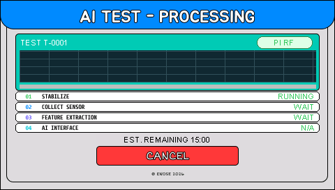
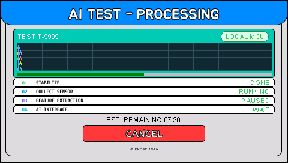
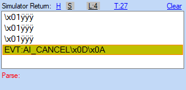

# Nextion V7 — QA revisi halaman 06 (27 November 2026)

Operator menyetujui perbaikan tTestId, badge tPi melengkung, dan geometri tStep1–4. V7 dibuat dari HMI V5 yang terverifikasi, bukan HMI V6 yang sedang terkunci oleh Editor. Perubahan UI hanya pada resource `6.pa`, `6.i`, `6.is`.

- Garis hitam asli x28–377 pada y48 dipulihkan; sisa garis dan batas panel dipertahankan. Badge lama persegi diganti bentuk 80 x 18 px radius 9, mint RGB (222,255,230), outline (54,133,74). Warna/font teks mengikuti atribut status pTest; crop image menggunakan picc=6 agar bentuk badge tidak tertimpa.
- tTestId (30,53,320,16), tPi (377,55,62,12), tStep1–4 (375,132/147/162/177,76,12). Font 12 px native tetap. Baris 14 px dengan interior 12 px; jarak 1 px; label asli dipertahankan.
- Seluruh resource selain 3 resource halaman 6 identik byte-for-byte, seluruh ID/nama, font resource, waveform ID 10, progress ID 3, tEta dan Cancel ID 8 tidak berubah. Directory checksum dan page CRC PASS. TFT header Basic, 480 x 272, 12 halaman PASS.

## Compiler dan simulator resmi

Nextion Editor 1.68.2 compile berhasil 0 error / 0 warning. TFT 3.586.744 bytes; RAM pTestRun 2.612/3.584, sisa 972 byte. HMI 15.286.454 bytes. SHA256 HMI `709cde6dce86b0d425c0072490d66abe29b8c61e3270bc522f7d81ab7b687e7e`; TFT `75589f599893c5300fbedcd1e6f9e2395d004934d846d54c5bd4efb2b4b2e64e`.

Simulator: 12/12 page navigation (sendme dan parse page ID), startup pTestRun, 3 batch perubahan status (initial/running/final), 32 titik sintetis waveform (8 per kanal), progress dan ETA PASS. Screenshot 480 x 272 menunjukkan garis utuh, badge rounded, TEST T-9999, LOCAL MCU, RUNNING, PAUSED tidak terpotong. Cancel pada batch gabungan `sendme` menghasilkan 32 byte sesuai target tetapi parser label kosong karena frame event ASCII. Uji Cancel terpisah: 27 bytes = 3 ACK + `EVT:AI_CANCEL` + CRLF; screenshot ASCII exact PASS. Uji Cancel via click handler simulator, bukan touch fisik atau penghentian aktuator. Data sintetis bukan hasil sensor fisik.

V7 dipromosikan ke `fix/nextion/` berdasarkan persetujuan operator setelah compile/simulator lulus. V5 rollback byte-identik ada di `archieve/verified_v5_rollback/`. Firmware, protokol listener, model, data dan hardware aktif tidak berubah. V7 belum diupload ke LCD fisik, dan klasifikasi RF500 lintas roasting masih belum valid. Uji fisik V7 diperlukan sebelum menyatakan hardware E2E V7 PASS.
